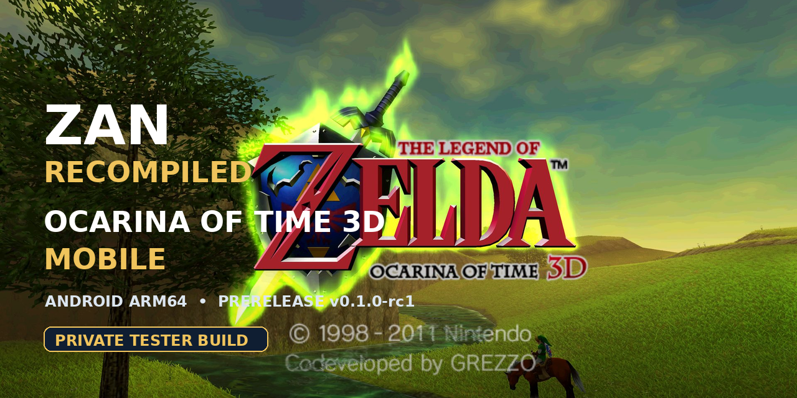

# Zan — Ocarina of Time 3D — Mobile



Private release repository for the prebuilt Android application. This repo
contains **only** release artifacts and documentation. It is not a source repo
and cannot be used to rebuild the APK.

See [LICENSE](LICENSE) before downloading. Redistribution, reverse engineering
and rebuilding are not permitted.

## Credits

This build is based on the **TriAevum** engine and Forge runtime. Credit and
thanks go to the TriAevum project and its contributors.

## Current prerelease

`v0.1.0-rc1` — see the [Releases](../../releases) page for the APK.

| Item | Value |
| --- | --- |
| Package | `org.triaevum.echoesoftime` |
| ABI | `arm64-v8a` |
| Minimum Android | 10 (API 29) |
| Renderer | Native Vulkan path with NRI where supported |
| Verified device | Xiaomi `surya`, Snapdragon 732G / Adreno 618, Android 12, Vulkan 1.1 |
| Not yet device-verified | Helio G85/G99, Mali-G52/G57 class |
| APK SHA-256 | `b497fdbb9ae076077b3f106b4014bb843f100c7efed2a9fb73613b81872de8c1` |

This is a **prerelease**. Stable `v0.1.0` will be published after more device
qualification, especially on Mali.

## Install and test

1. Download `Zan-OoT3D-Mobile-arm64.apk` from Releases.
2. Allow installation from the file manager/browser on Android.
3. Install the APK. No ROM or game data is bundled.
4. Use the in-app Forge to select your own locally stored decrypted
   `.3ds`/`.cci`. Nothing is uploaded.

## Bug reports

If a glitch or crash happens, attach this one automatically written file from
Discord; no menu action is needed:

```text
Android/data/org.triaevum.echoesoftime/files/data/logs/Zan-bug-report.txt
```

It is redacted: user paths, title folders and hashes are removed. Do not attach
your ROM or save files.
